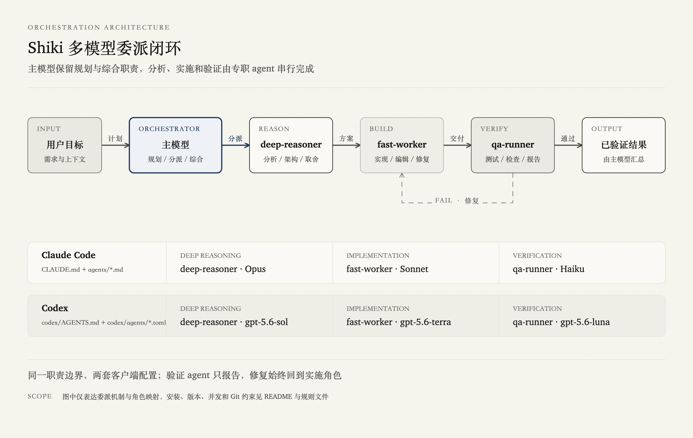

# Shiki

面向 **Claude Code**、**Codex** 与 **Grok Build** 的多模型 agent 编排配置模板。

它不是一个可运行的应用或 agent 框架，而是一组可复用的指令文件和角色配置。主模型默认直接完成普通工作；只有有界委派能提高质量、速度、独立性或上下文管理时，才按任务分派专职 agent。

## 工作方式

| 角色 | 职责 | Claude Code | Codex | Grok Build |
| --- | --- | --- | --- | --- |
| 主模型 | 直接完成普通工作；澄清、综合，并在必要时分派 | 当前会话模型 | 当前会话模型 | 当前会话模型 |
| `deep-reasoner` | 重大根因、架构、困难取舍、独立审查 | Opus + high | `gpt-5.6-sol` + high | `grok-4.6` + high + `plan` |
| `fast-worker` | 已确定边界的实施、样板代码、批量编辑 | Sonnet + medium | `gpt-5.6-terra` + medium | `grok-4.6` + medium |
| `qa-runner` | 执行指定测试、类型检查或 lint，并报告证据 | Haiku | `gpt-5.6-luna` + low | `grok-4.6` + low |

典型流程：



图中展示角色边界与验证回流，不表示每项任务都要经过固定流程。各平台模型映射见上表；细节见对应指南。

模板默认直接处理；仅当有界委派能明确提升质量、速度、独立性或上下文时选择性分派。按生产、安全、不可逆操作等影响升级独立核验。完整规则请查看 [Claude Code 指令](./CLAUDE.md)、[Codex 指令](./codex/AGENTS.md) 与 [Grok 指令](./grok/AGENTS.md)。

用户明确要求独立 QA 或审查时必须保持独立性；高影响任务也按风险升级独立核验。验证失败由主模型根据证据路由，原因明确时可交回实施方；根因不明、方案冲突或反复无进展时回到主模型重新判断。三平台共享角色语义，但权限、调用和运行时覆盖能力按各自配置而不同。完整可审计流程是可选参考：[docs/verified-lane.md](./docs/verified-lane.md)。

模型选择留在角色配置。当前模板保持 Sol / Terra / Luna 与 Opus / Sonnet / Haiku 的分层；Astra 与 Fable 5.1 是主模型处理困难问题时的升级选项，暂不增加角色。模型优先级因平台而异：Codex 角色文件中的显式模型优先；Claude 支持调用时覆盖；Grok 还受 role/persona 配置影响。安装后查看实际子会话确认。Claude 使用 Fable 5.1 前需要 Claude Code 2.1.255 或更高版本。`opus` 不会自动切换到 Fable；官方直连当前对应 Opus 5 / Sonnet 5，其他 provider 的别名版本可能不同。详见 [Claude 模型配置](https://code.claude.com/docs/en/model-config)与[子任务 effort](https://code.claude.com/docs/en/sub-agents)。

## 快速配置

先克隆仓库并进入根目录。**优先将 agent 与共享规则安装为用户级配置**，再只用项目级规则覆盖该项目独有的构建命令、风险边界或例外；不要把模板直接覆盖进已有项目规则。

### Claude Code

安装三个 agent：

```bash
mkdir -p ~/.claude/agents
cp -i agents/deep-reasoner.md ~/.claude/agents/deep-reasoner.md
cp -i agents/fast-worker.md ~/.claude/agents/fast-worker.md
cp -i agents/qa-runner.md ~/.claude/agents/qa-runner.md
```

`cp -i` 会在覆盖同名文件前询问。如果目标文件已存在，请拒绝覆盖，比较现有定义与模板后再手动合并。

将 [`CLAUDE.md`](./CLAUDE.md) 作为共享规则安装到你的 Claude Code 用户级规则位置；如本地版本只支持项目规则，则手动合并到项目规则。项目级仅用于覆盖：

- 目标项目**没有** `CLAUDE.md`：可复制模板。

  ```bash
  cp CLAUDE.md /path/to/your-project/CLAUDE.md
  ```

- 目标项目**已有** `CLAUDE.md`：手动合并 `Orchestration` 等所需章节，**不要直接覆盖**原有的构建命令、Git 约定和项目规则。

如需只在单个项目中使用 agent，也可以将定义放到目标项目的 `.claude/agents/` 目录。

### Codex

安装三个 custom agent：

```bash
mkdir -p ~/.codex/agents
cp -i codex/agents/deep-reasoner.toml ~/.codex/agents/deep-reasoner.toml
cp -i codex/agents/fast-worker.toml ~/.codex/agents/fast-worker.toml
cp -i codex/agents/qa-runner.toml ~/.codex/agents/qa-runner.toml
```

`cp -i` 会在覆盖同名文件前询问。如果目标文件已存在，请拒绝覆盖，比较现有定义与模板后再手动合并。

将 [`codex/AGENTS.md`](./codex/AGENTS.md) 作为用户级共享规则安装（例如支持该层级的版本可使用 `~/.codex/AGENTS.md`）；项目级仅用于覆盖：

- 目标项目**没有** `AGENTS.md`：可复制模板。

  ```bash
  cp codex/AGENTS.md /path/to/your-project/AGENTS.md
  ```

- 目标项目**已有** `AGENTS.md`：手动合并编排章节，**不要直接覆盖**现有规则。

如需项目级 custom agent，可将 TOML 定义放到目标项目的 `.codex/agents/` 目录。Codex 的配置字段和可用模型可能随版本变化，请根据本地版本调整模板。

### Grok Build

安装三个用户级 agent 与同名 roles（官方路径：`~/.grok/agents/`、`~/.grok/roles/`）：

```bash
mkdir -p ~/.grok/agents ~/.grok/roles
cp -i grok/agents/*.md ~/.grok/agents/
cp -i grok/roles/*.toml ~/.grok/roles/
```

先将 [`grok/AGENTS.md`](./grok/AGENTS.md) 作为用户级全局规则安装；项目级仅用于覆盖：

- 目标项目**没有** `AGENTS.md`：

  ```bash
  cp grok/AGENTS.md /path/to/your-project/AGENTS.md
  ```

- 目标项目**已有** `AGENTS.md`：手动合并编排章节，**不要直接覆盖**。

用户级**全局规则**请放到官方目录 `~/.grok/rules/`（对所有项目生效；项目内更深路径的规则优先）：

```bash
mkdir -p ~/.grok/rules
cp -i grok/AGENTS.md ~/.grok/rules/AGENTS.md
```

避免与 Claude 全局规则双份注入：在 `~/.grok/config.toml` 中设置（片段见 `grok/config.snippet.toml`）：

```toml
[compat.claude]
agents = false
```

项目级 agent 可放到 `<项目>/.grok/agents/`。effort / 兼容层细节见 [GROK.md](./GROK.md)。可用模型以 `grok models` 为准。

## 验证配置

不要只确认文件已复制，还要确认委派实际发生。

1. 检查三个 agent 文件是否位于预期的用户级或项目级目录，且名称与指令文件中的路由名称一致。
2. 显式要求主模型调用 `deep-reasoner` 完成一个小型方案任务，通过当前客户端提供的 agent 状态或日志确认委派发生：
   - Codex CLI：`/agent`
   - Grok Build：`Ctrl+G` 任务窗、`/config-agents`、`grok inspect`
3. 可选做路由 smoke：拼写修正应直接处理；独立、复杂且边界清晰的子任务才可能选择性委派。未分派不单独构成失败，应结合任务边界与客户端日志判断。
4. 核对实际 agent 使用的模型、effort 与配置来源；按对应平台的配置优先级解释差异，不假定三平台覆盖顺序相同。如果没有分派，优先检查指令文件是否被加载、agent 路径是否正确，以及本地版本是否支持对应配置。

验证时应关注“是否发生委派、派给谁、使用什么模型”，不要仅凭总 token 或费用推断结果。

## 仓库结构

```text
.
├── README.md                    # Claude Code / Codex / Grok 统一入口
├── CLAUDE.md                    # Claude Code 编排与工程规则模板
├── agents/                      # Claude Code agent 定义
│   ├── deep-reasoner.md
│   ├── fast-worker.md
│   └── qa-runner.md
├── CODEX.md                     # Codex 侧扩展说明
├── codex/
│   ├── AGENTS.md                # Codex 编排与工程规则模板
│   └── agents/                  # Codex custom agent 定义
│       ├── deep-reasoner.toml
│       ├── fast-worker.toml
│       └── qa-runner.toml
├── GROK.md                      # Grok Build 侧扩展说明
└── grok/
    ├── AGENTS.md                # Grok 编排与工程规则模板
    ├── config.snippet.toml      # 建议写入 ~/.grok/config.toml 的兼容片段
    ├── agents/                  # Grok agent 定义
    │   ├── deep-reasoner.md
    │   ├── fast-worker.md
    │   └── qa-runner.md
    └── roles/                   # 按 type 的 reasoning_effort 默认
        ├── deep-reasoner.toml
        ├── fast-worker.toml
        └── qa-runner.toml
```

## 使用注意

- **先合并规则，再按项目调整。** 模板中的 Git、计划文档和验证要求不一定适合所有仓库。
- **模型映射不是硬性依赖。** 表中名称反映当前仓库配置；本地不可用时，应选择同类能力模型并同步修改定义。安装或升级后以实际子会话为准。
- **验证 agent 只报告，不修复。** 它运行已确定的检查并回传命令、退出码和失败证据；主模型决定是否与怎样修复。
- **并行写入要谨慎。** 只有接口稳定、范围不冲突的任务才可并行；有依赖时先确定契约再分派。
- **委派不等于节省成本。** 主要收益是职责隔离、验证闭环和保持主会话上下文清晰。
- **Grok 用户优先使用 `~/.grok/agents`。** 兼容层也会读 `~/.claude/agents`，但 Claude 模型名（opus/sonnet/haiku）在 Grok 上通常无效。

## 参考

- [Claude Code 编排规则](./CLAUDE.md)
- [Claude Code agent 定义](./agents/)
- [Codex 扩展说明](./CODEX.md)
- [Codex 编排规则](./codex/AGENTS.md)
- [Codex custom agent 定义](./codex/agents/)
- [Grok Build 扩展说明](./GROK.md)
- [Grok 编排规则](./grok/AGENTS.md)
- [Grok agent 定义](./grok/agents/)
